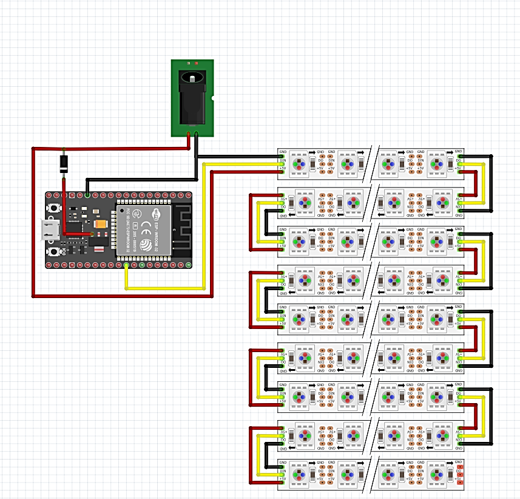

# UniPy - LightGrid

A 9×9 addressable RGB LED matrix driven by an ESP32, controllable over USB serial or Wi‑Fi (UDP), with a 3D‑printable case.

## Files

| File | Description |
|---|---|
| `auto_lg_combined_recon.ino` | Firmware for the 9×9 matrix (81 LEDs) |
| `led_strip.ino` | Firmware variant for a 300‑LED strip |
| `LightGrid_shell.stl` | Front shell |
| `LED_holder.stl` | LED holder plate |
| `down_side.stl` | Back cover |
| `button.stl` | Button |

## Hardware

- ESP32 dev board
- Addressable RGB LED strips (9 rows × 9 LEDs), data on GPIO 18
- 5 V power supply with DC jack and a diode (see schematic)
- 3D‑printed parts from the STL files

## Setup

1. Install the ESP32 board support (core 2.x) and the `NeoPixelBus`, `AsyncTCP` and `ESP32Ping` libraries.
2. Wire everything as in the schematic.
3. Open `auto_lg_combined_recon.ino`, check `DATA_PIN` and `NUM_LEDS`, and upload.

## Usage

Send 4‑byte commands: `0x80 | command`, `R`, `G`, `B`.

| Command | Action |
|---|---|
| 0–99 | Set that pixel to `R G B` |
| 110 | Clear all LEDs |
| 120 | Get connected device IPs (Wi‑Fi, AP mode) |

- **Serial:** 500000 baud
- **Wi‑Fi:** UDP port 4210. The board joins `mcuNET` if it exists, otherwise it creates it at `10.10.10.1`.

Change the default Wi‑Fi password (`PASSWORD_NET`) in the sketch before use.

